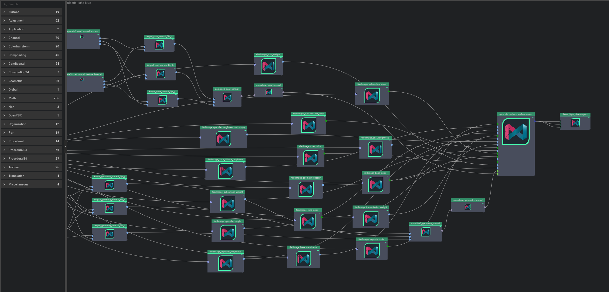
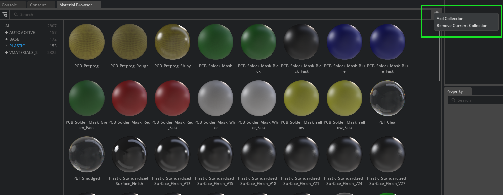

# NVIDIA PhysicalAI-SimReady-Materials

**NVIDIA PhysicalAI-SimReady-Materials** is an open collection of USD
materials and textures authored with `UsdShade`, MaterialX, and OpenPBR 1.1.
The materials are designed for NVIDIA Omniverse and for other USD-capable DCC
applications and runtimes that support MaterialX and OpenPBR.

This repository is the public landing page for the library. To keep the Git
repository lightweight, the material data is distributed as category archives
from GitHub Releases instead of being checked in as individual material and
texture files.

## Contents

- [Overview](#overview)
- [Download](#download)
- [Package Layout](#package-layout)
- [Categories](#categories)
- [Requirements](#requirements)
- [Usage](#usage)
- [Material Inheritance](#material-inheritance)
- [Omniverse](#omniverse)
- [Other DCCs and Runtimes](#other-dccs-and-runtimes)
- [Contributing](#contributing)
- [License](#license)
- [Acknowledgments](#acknowledgments)
- [Contact](#contact)

## Overview

The library contains 1,705 physically based materials distilled from NVIDIA
[vMaterials](https://developer.nvidia.com/vmaterials). Materials are organized
by category, and each category is published as a separate downloadable archive
on the [Releases](https://github.com/NVIDIA-Omniverse/PhysicalAI-SimReady-Materials/releases)
page.

### Key Features

- **USD-native materials**: Authored as USD `UsdShade` materials.
- **OpenPBR-based**: Built around the
  [OpenPBR 1.1](https://github.com/AcademySoftwareFoundation/OpenPBR/tree/v1.1)
  material model.
- **MaterialX shader graphs**: Uses MaterialX shader nodes for portable
  physically based shading.
- **Texture support**: Texture assets are provided in `.jpg` format for broad
  compatibility and efficient download size.
- **Simulation metadata**: Includes SimReady non-visual sensor attributes for
  use cases such as Lidar, RADAR, and ultrasonic simulation.

## Download

Download material archives from the latest GitHub Release:

[https://github.com/NVIDIA-Omniverse/PhysicalAI-SimReady-Materials/releases/latest](https://github.com/NVIDIA-Omniverse/PhysicalAI-SimReady-Materials/releases/latest)

Each material category is provided as a separate `.zip` file under release
assets. Download only the categories you need, or download all category
archives for the complete library.

If you use the GitHub CLI, the following command downloads all release `.zip`
assets for the latest release:

```bash
gh release download \
  --repo NVIDIA-Omniverse/PhysicalAI-SimReady-Materials \
  --pattern '*.zip'
```

After downloading, extract the category archives into the same destination
directory so that their shared root package is preserved and category folders
merge together.

> The automatically generated GitHub "Source code" archives contain this
> repository's documentation files, not the material library data. Use the
> category `.zip` assets from the release.

## Package Layout

The Git repository contains documentation, license, security, contribution, and
image files:

```text
.
|-- CONTRIBUTING.md
|-- LICENSE.md
|-- README.md
|-- SECURITY.md
`-- images/
```

After extracting one or more material category archives, the material package
uses this layout:

```text
PhysicalAI-SimReady-Materials/
|-- open_pbr_uber_base_class.usda
`-- Materials/
    |-- Carpet/
    |   |-- Carpet_Woven.usda
    |   `-- textures/
    |       `-- ...
    |-- Ceramic/
    |   |-- Ceramic_Tiles_Diamond_Antique_White.usda
    |   `-- textures/
    |       `-- ...
    `-- ...
```

The file `open_pbr_uber_base_class.usda` is shared by the materials. Keep it at
the root of the extracted package and preserve the relative paths under
`Materials/`.

## Categories

The current library includes the following material categories:

| Category | Materials |
| --- | ---: |
| Carpet | 13 |
| Ceramic | 280 |
| Concrete | 76 |
| Fabric | 13 |
| Glass | 94 |
| Ground | 64 |
| Leather | 176 |
| Liquids | 16 |
| Masonry | 21 |
| Metal | 609 |
| Paint | 69 |
| Paper | 10 |
| Plastic | 146 |
| Skin | 4 |
| Stone | 114 |
| **Total** | **1,705** |

## Requirements

- [OpenPBR 1.1](https://github.com/AcademySoftwareFoundation/OpenPBR/tree/v1.1)
- [OpenUSD 24.08](https://github.com/PixarAnimationStudios/OpenUSD/tree/v24.08)
- [MaterialX 1.38.10-OpenPBR](https://github.com/AcademySoftwareFoundation/MaterialX/tree/v1.38.10-OpenPBR)

## Usage

1. Download the desired category archives from
   [Releases](https://github.com/NVIDIA-Omniverse/PhysicalAI-SimReady-Materials/releases/latest).
2. Extract the archives into a common destination.
3. Reference, sublayer, or load materials from the extracted
   `PhysicalAI-SimReady-Materials/Materials/<Category>/` folders into your USD
   stage.
4. Keep the extracted package structure intact so material references to
   textures and `open_pbr_uber_base_class.usda` continue to resolve.

For example, a material can be referenced from a path like:

```text
PhysicalAI-SimReady-Materials/Materials/Fabric/Fabric_Canvas.usda
```

When copying or relocating materials, move the complete extracted package or
preserve the same relative layout around the category folder and
`open_pbr_uber_base_class.usda`.

## Material Inheritance

All materials inherit from `open_pbr_uber_base_class.usda` for consistency and
efficiency. The base class defines the shared OpenPBR material interface,
MaterialX shader graph, common texture mapping behavior, semantic labels, and
SimReady non-visual sensor attributes.

### Material Attributes

The base class organizes inputs into the following groups:

- **Base**: `base_weight`, `base_color`, `base_diffuse_roughness`,
  `base_metalness`
- **Specular**: `specular_weight`, `specular_color`, `specular_roughness`,
  `specular_ior`, `specular_roughness_anisotropy`
- **Transmission**: `transmission_weight`, `transmission_color`,
  `transmission_depth`, `transmission_scatter`,
  `transmission_dispersion_scale`, `transmission_abbe_number`
- **Subsurface**: `subsurface_weight`, `subsurface_color`,
  `subsurface_radius`, `subsurface_radius_scale`,
  `subsurface_scatter_anisotropy`
- **Fuzz**: `fuzz_weight`, `fuzz_color`, `fuzz_roughness`
- **Coat**: `coat_weight`, `coat_color`, `coat_roughness`, `coat_ior`,
  `coat_darkening`, `coat_roughness_anisotropy`, `coat_normal_scale`
- **Thin Film**: `thin_film_weight`, `thin_film_ior`,
  `thin_film_thickness`
- **Emission**: `emission_luminance`, `emission_color`
- **Geometry**: `geometry_opacity`, `geometry_thin_walled`,
  `geometry_normal_scale`
- **UV Controls**: `uvtiling`, `uvoffset`

### Shader Graph

The base material implements a MaterialX `UsdShade` shader graph using the
OpenPBR Surface shader as the material model.

- **Texture mapping**: Many parameters can be driven by texture resources.
  `ND_tiledimage_<type>` nodes support UV tiling and offset controls.
- **Normal mapping**: Dedicated normal map processing includes flip controls
  for R, G, and B channels to switch between DirectX and OpenGL normal map
  encodings.

<div align="center">
  
</div>

### Semantic Labels

The base class includes semantic metadata such as:

- `semantics:labels:material = ["base"]`
- `semantics:labels:OpenPBR_Ver = ["1.1"]`
- `semantics:labels:vMaterial_Ver = ["2.2"]`

### Non-Visual Sensor Attributes

SimReady non-visual attributes provide material properties used for sensor
simulation outside the visible spectrum. They support Omniverse RTX sensor
simulation workflows through:

- `omni:simready:nonvisual:base`
- `omni:simready:nonvisual:coating`
- `omni:simready:nonvisual:attributes`

## Omniverse

The library can be used from a local filesystem location or uploaded to
Omniverse Nucleus.

Recommended workflow:

1. Extract the required category archives.
2. Upload or mount the complete extracted package.
3. Reference, sublayer, or load materials into a USD stage.
4. Place referenced materials under a hierarchy such as `/World/Looks` or
   `/World/Materials`.
5. Author override opinions on material parameters as needed.

To browse the extracted library in the Omniverse Material Browser Extension,
add the extracted `PhysicalAI-SimReady-Materials/Materials` folder, or selected
category folders, to the browser collections.

<div align="center">
  
</div>

## Other DCCs and Runtimes

The materials are intended for USD and MaterialX-capable tools and runtimes,
including:

- NVIDIA Omniverse RTX in Omniverse Kit SDK and Sensor RTX API
- Pixar USD
- Autodesk Maya
- SideFX Houdini
- Other USD-capable tools

## Contributing

Please see [CONTRIBUTING.md](CONTRIBUTING.md) for contribution guidelines.

## License

The materials and textures are licensed under the [MIT-0 License](LICENSE.md).

## Acknowledgments

- [Academy Software Foundation](https://www.aswf.io/) for
  [OpenPBR](https://github.com/AcademySoftwareFoundation/OpenPBR)
- [Academy Software Foundation](https://www.aswf.io/) for
  [MaterialX](https://github.com/AcademySoftwareFoundation/MaterialX)
- [Pixar and AOUSD](https://aousd.org/) for
  [OpenUSD](https://github.com/PixarAnimationStudios/OpenUSD)
- [NVIDIA](https://www.nvidia.com/) for
  [vMaterials](https://developer.nvidia.com/vmaterials)
- [NVIDIA Omniverse](https://www.nvidia.com/en-us/omniverse/)

## Contact

For questions, open an issue in this repository:

[https://github.com/NVIDIA-Omniverse/PhysicalAI-SimReady-Materials/issues](https://github.com/NVIDIA-Omniverse/PhysicalAI-SimReady-Materials/issues)
